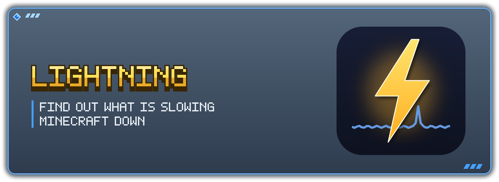
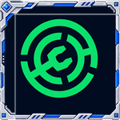
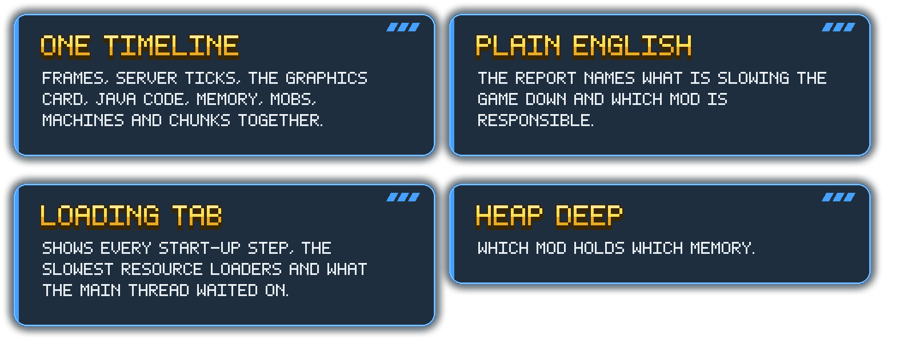
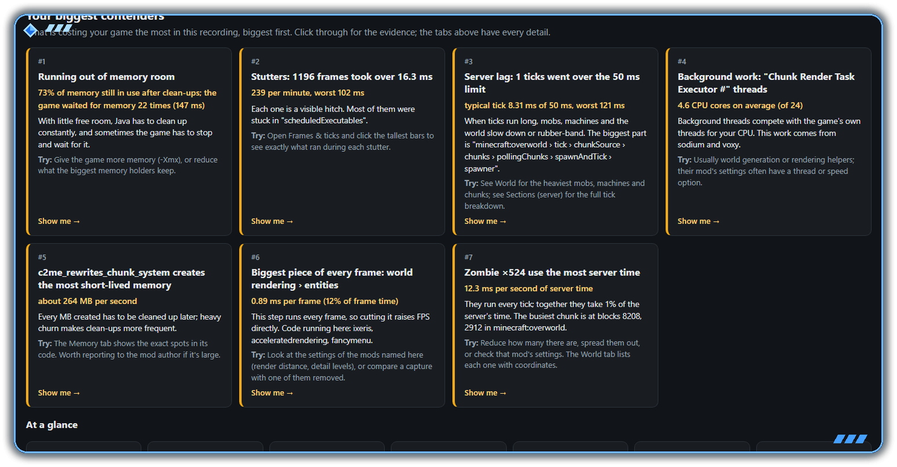
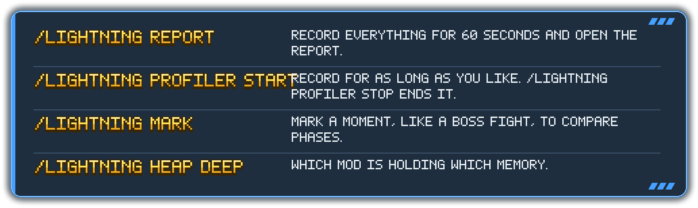
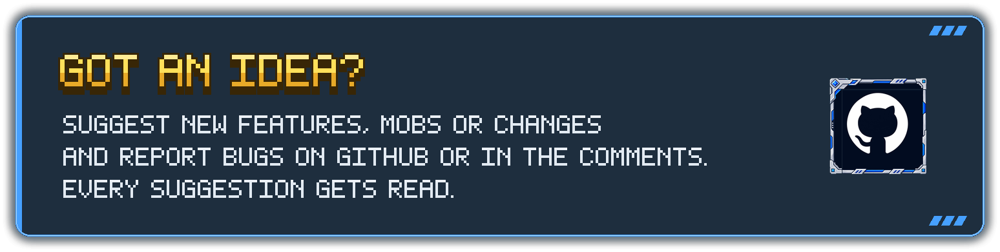

<picture></picture>

 

<picture></picture>

<picture></picture>

<picture></picture>

<picture></picture>

<picture></picture>

Made with AI assistance.

More technical details: [docs/DETAILS.md](docs/DETAILS.md)
