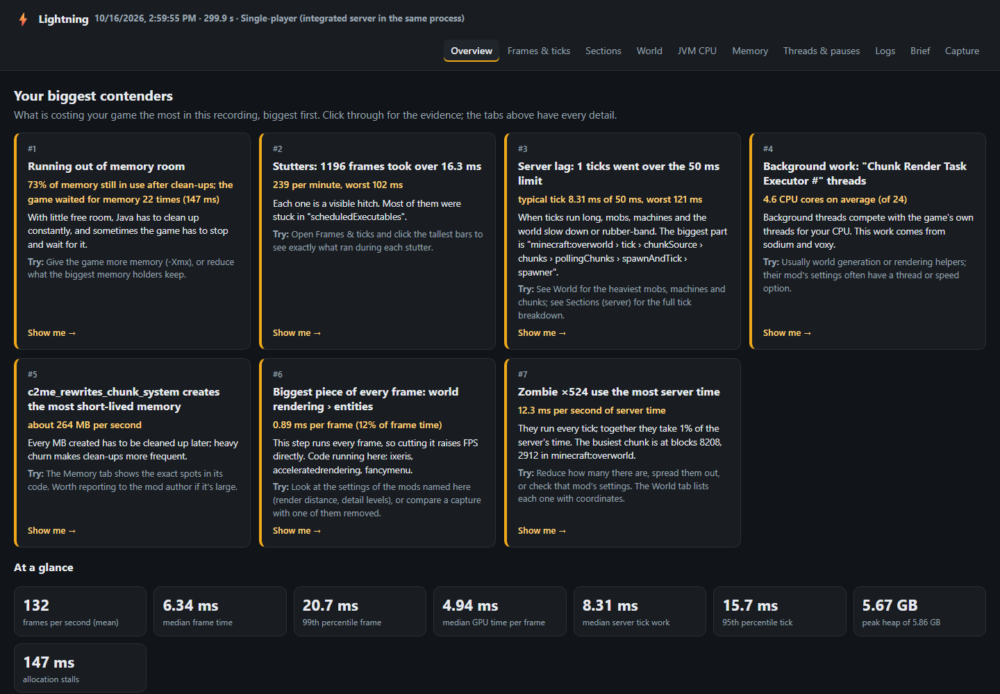
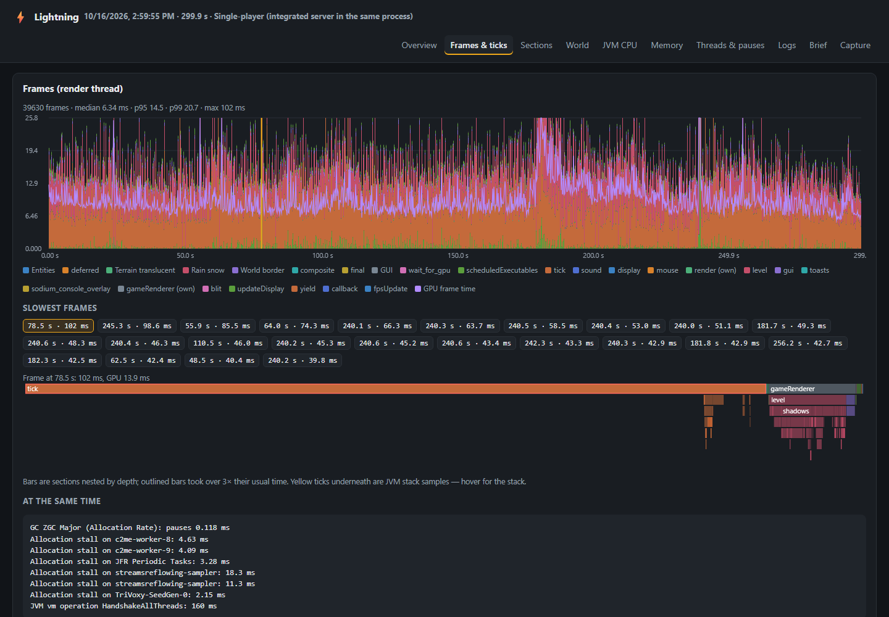
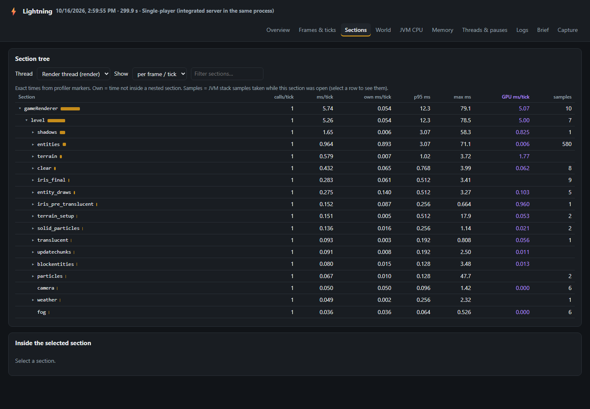
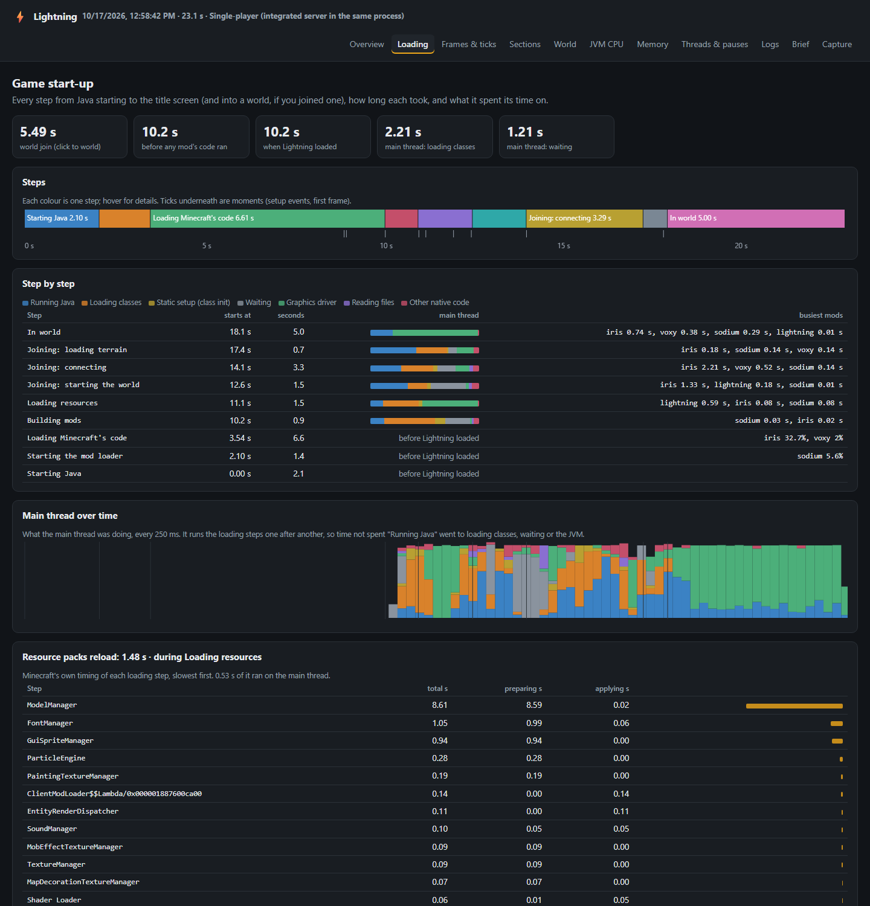
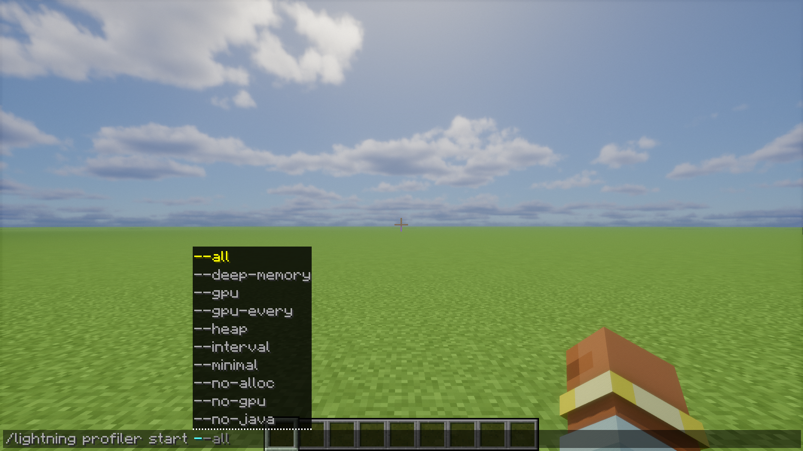

<p align="center"></p>

<p align="center">
  
  
  
  
</p>

**Lightning** finds out what's making your game slow and tells you in plain English. A profiler for frames, ticks, graphics, memory and mods, for Minecraft 1.21.1 with NeoForge.

Type `/lightning report`, play for a minute, and a report opens in your browser. Its first page lists the biggest problems with the evidence underneath.

<p align="center"></p>

## What it records

- **Frames and server ticks** on one timeline, with stalls, garbage-collection pauses and log lines marked where they happened.
- **Graphics card time** per render step, including shader packs (Iris) and distant terrain.
- **Which mod** is behind slow code, memory use and memory churn.
- **Chunks, mobs and machines** that cost the most server time, with a chunk map.
- **Phases:** mark moments like "boss fight" and compare them side by side.

<p align="center"></p>

<p align="center"></p>

## Slow start-up or world joins

Every loading step is timed from the moment Java starts: the slowest resource loaders, which mods' mixins slow loading, and what the game sat waiting on. Add this to the game's Java arguments, launch, and open the report's **Loading** tab:

```
-Dlightning.startup=join -XX:StartFlightRecording=name=lightning,settings=profile,class-loading=true
```

Use `title` instead of `join` to stop at the title screen.

<p align="center"></p>

## Commands

| Command | What it does |
|---|---|
| `/lightning report [seconds]` | Record for a while (default 60 s), then open the report |
| `/lightning profiler start` / `stop` / `cancel` / `status` | Manual recording |
| `/lightning mark <name>` | Start a named phase |
| `/lightning heap` | Quick look at what's filling memory |
| `/lightning heap deep` | Full memory breakdown by mod (freezes the game for a few seconds) |

<p align="center"></p>

Lightning reports its own overhead, and if the game crashes mid-recording the report is rebuilt the next time you start. Each recorder can be turned on or off in **Mods → Lightning → Config**.

## Bugs and ideas

Please post them in **[Issues](https://github.com/SteelArchadian/Lightning/issues)**. That's where every report gets read and tracked, rather than in CurseForge or Modrinth comments.

## Building

```
./gradlew build
```

The jar is written to `build/libs/`.

## Credits and license

Licensed under the GNU Lesser General Public License v3.0 only: see [LICENSE](LICENSE) (with the GPL text it builds on in [COPYING](COPYING)). Made for the Foundation modpack, with AI assistance.
